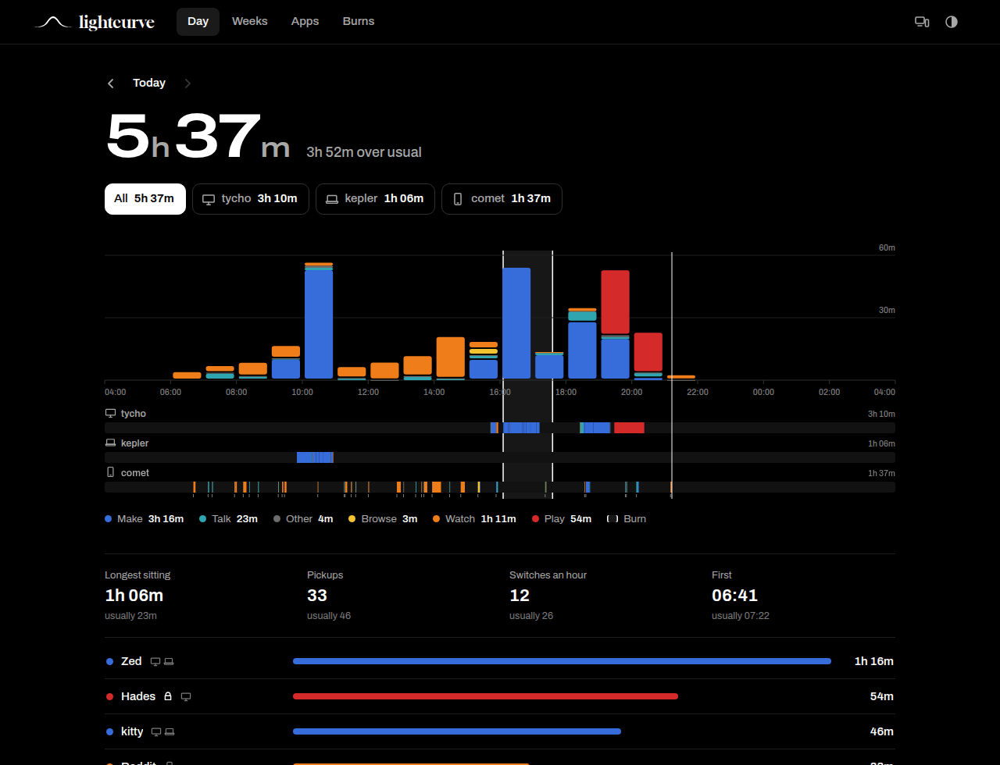
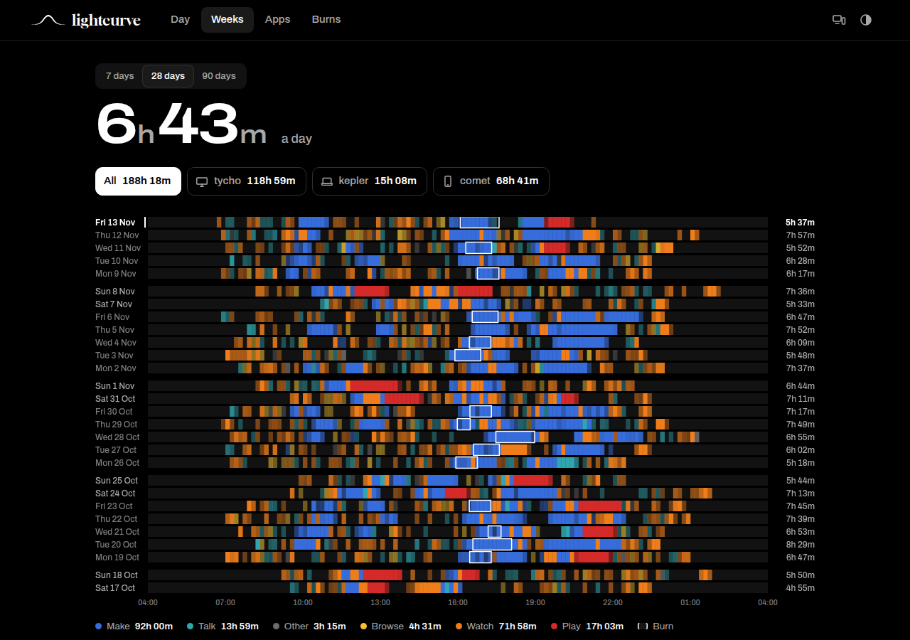
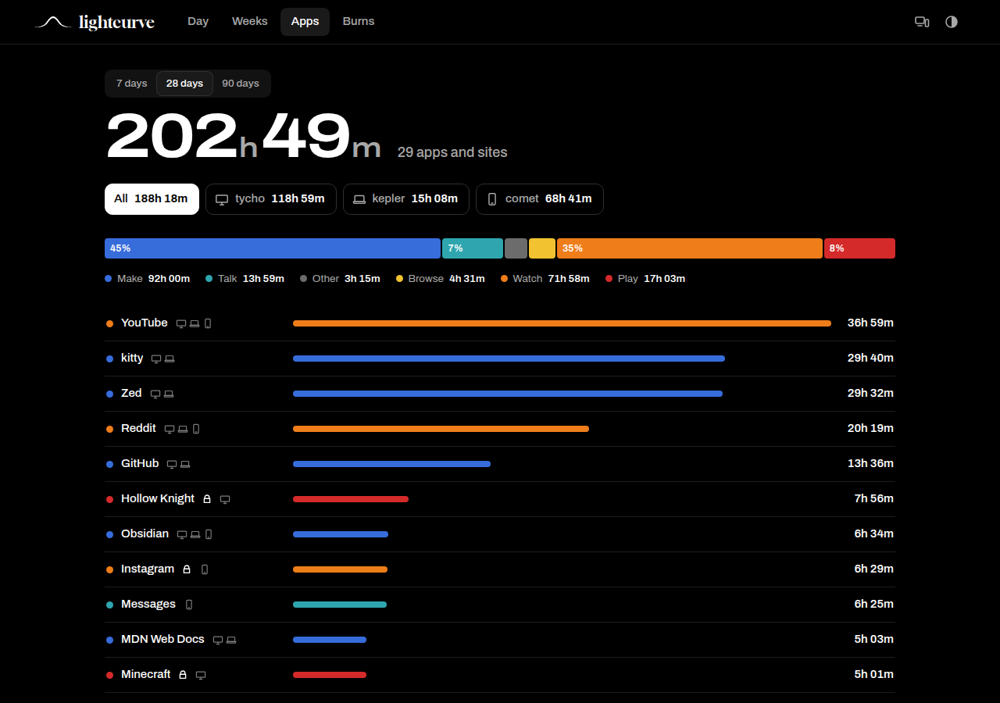
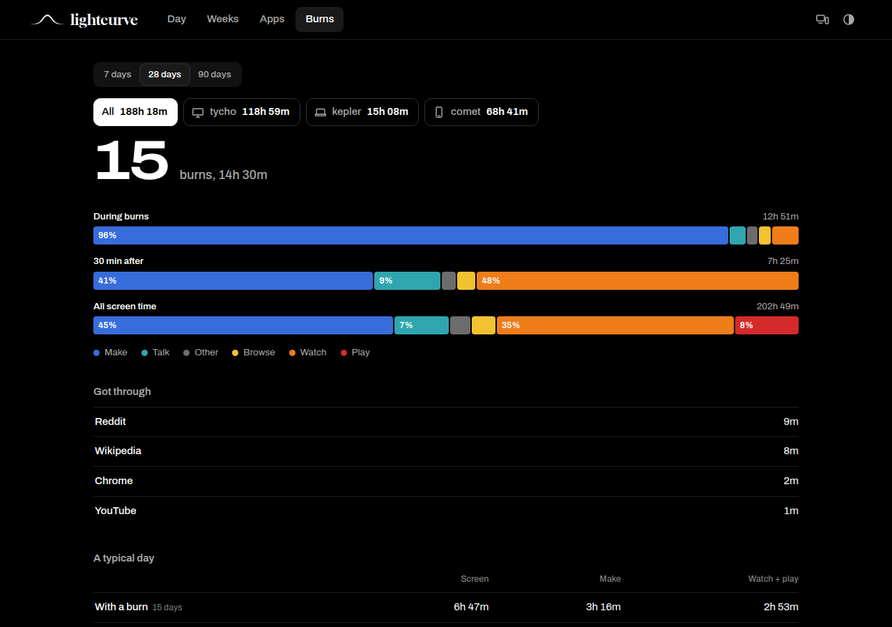
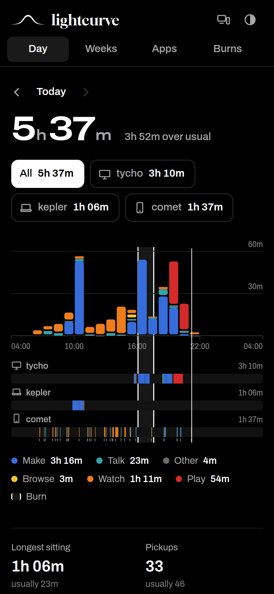

# lightcurve

Screen time across every computer and phone you use, in one place.



It replaces [waytime](https://github.com/ieatfood314/waytime), which counted time per app on one KDE machine.

- **Day:** how long your screens were on, hour by hour, on each device.
- **Weeks:** one row a day, so you can see patterns.
- **Apps:** every app and site, ranked by time.
- **Burns:** what you did during [ignition](https://github.com/ieatfood314/ignition) burns, and right after them.

Two screens on at once count once. Every number is compared with your own usual, not with a target.







The screenshots use made-up data (`lightcurve serve --demo`).

## Install

You need one hub, then a tracker on each device.

### The hub

Any Linux machine that stays on and that your devices can reach. Python 3 and nothing else.

```sh
curl -fsSL https://raw.githubusercontent.com/ieatfood314/lightcurve/main/install.sh | sh -s -- --serve
```

It listens on `127.0.0.1:4625`. Nothing in lightcurve asks for a password, so don't put it on the open Internet: publish it on a private network such as [Tailscale](https://tailscale.com/kb/1312/serve) (`tailscale serve --bg 4625`), or pass `--host` with a LAN address if you trust your LAN.

### A Linux computer (KDE Plasma 6, Wayland)

The tracker needs `python-dbus` and `python-gobject` (Arch names; `python3-dbus python3-gi` on Debian).

```sh
curl -fsSL https://raw.githubusercontent.com/ieatfood314/lightcurve/main/install.sh | sh -s -- --hub http://your-hub:4625
```

Leave `--hub` off and it keeps the record on that machine alone; the `lightcurve` command still works. If waytime is running it is stopped, and its history comes over as daily totals.

### An Android phone

Install the APK from the [latest release](https://github.com/ieatfood314/lightcurve/releases/latest) (or add this repository to [Obtainium](https://obtainium.imranr.dev)). Give it the hub's address and allow usage access. The first sync brings in about a week of history that Android already had. If [doppler](https://github.com/ieatfood314/doppler) is installed too, the app hands it today's total after each sync, for its 2×2 widget.



## The command

```
lightcurve                 today so far
lightcurve yesterday       or any day: 2026-11-08, -3, monday
lightcurve week [N]        the last 7 (or N) days, a line each
lightcurve things [N]      apps and sites over the last 7 (or N) days
lightcurve devices         every device the hub knows, and when it last reported
lightcurve status          this machine's tracker
lightcurve sync            send what's waiting, now
lightcurve connect URL     point this machine at a hub
```

Add `--json` to any report.

## How it counts

Everything is stored as spans: one unbroken stretch of one thing in front of you on one device. Nothing is rounded into daily totals, so every number can be traced back.

- **A day runs from 04:00 to 04:00**, so a late night stays with the day it belongs to.
- **Lit** is wall-clock time with at least one screen in use. Per-device times can add up to more.
- **On a computer** a span runs while a window has focus, the screen isn't locked, and you are there. Three minutes without touching anything and the tracker starts to doubt; come back within five and you were reading, stay away longer and the span ends at your last touch. A playing video keeps it going without input, for two hours at most. The bare desktop is never counted.
- **On a phone** a span runs while an app is in front with the screen on.
- **A visit** is one thing held without leaving it for more than 45 seconds. **A sitting** is screen time with no break of five minutes.
- **Categories** (make, watch, talk, play, browse, other) come from a built-in list and, on Android, the app's own declared category. They are guesses. Click anything to say what it really is; your answer applies everywhere.

## What it keeps, and what it doesn't

- The window's class or the app's package id, with start and end times.
- For browsers, the site, read from the end of the window title ("… - YouTube — Firefox"). If the title doesn't end in something short enough to be a site's name, nothing is kept and the time is just the browser's. Full titles and addresses are never stored.
- Phone unlock times.

All of it lives in SQLite files you own: `~/.local/share/lightcurve/` on the hub and on each computer. There are no accounts and nothing leaves your machines.

## ignition

If [ignition](https://github.com/ieatfood314/ignition) runs on the hub's machine, lightcurve finds it by itself. Otherwise put its address under *Devices* on the dashboard. lightcurve only uses ignition's ordinary API: it reads the burns and the block list, and adds to the block list when you ask it to. ignition's own rule still holds, so nothing comes off the list from here.

The comparison of days with and without a burn only appears once there are three of each, and it is a description, not proof: you don't choose burn days at random.

## Update and remove

```sh
~/.local/share/lightcurve/app/update.sh
```

```sh
~/.local/share/lightcurve/app/uninstall.sh
```

`uninstall.sh --delete-data` removes the record as well.

## Built on

Python's standard library for the hub, the tracker's storage and the command; `python-dbus` and GLib for talking to KWin. The idle detection speaks the Wayland `ext-idle-notify-v1` protocol directly. The Android app is plain Kotlin with no libraries. The dashboard is one HTML file, one stylesheet and one script, set in [Archivo](https://fonts.google.com/specimen/Archivo), with the name in [Gloock](https://fonts.google.com/specimen/Gloock) (both SIL Open Font License, shipped in `web/fonts`).

## Disclaimer

🤖 This project was written with Claude: a human chose what to build and checked that it works; the AI wrote the code. Read it before you run it, as you should with any stranger's daemon.

MIT licensed.
